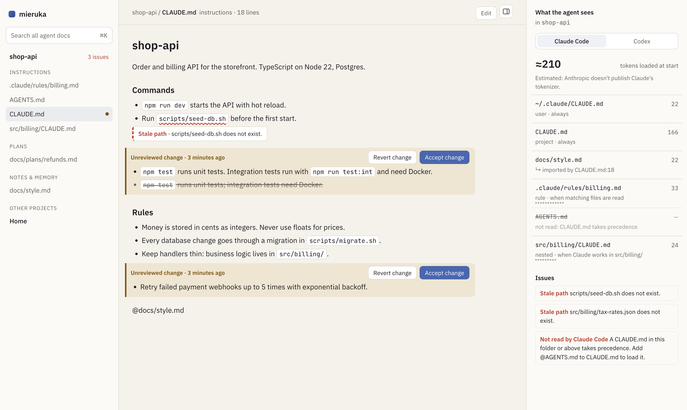

<p align="center">
  <picture>
    <source media="(prefers-color-scheme: dark)" srcset=".github/readme/logo-dark.svg">
    
  </picture>
</p>

<p align="center">
  See what your coding agent sees.<br>
  A local app for the Markdown files Claude Code and Codex read. It shows which ones the agent loads, what is wrong in them, and what changed since you last looked.
</p>

<p align="center">
  <a href="https://github.com/ayokiru/mieruka/actions/workflows/ci.yml"></a>
  
  <a href="LICENSE"></a>
</p>

<p align="center">
  <picture>
    <source media="(prefers-color-scheme: dark)" srcset=".github/readme/ui-dark.png">
    
  </picture>
</p>

> [!NOTE]
> mieruka is in early development. It runs on your machine only and never sends anything anywhere.

## Why

A coding agent starts every session by reading instruction files, and the rules for which ones are surprisingly hard to keep in your head:

- Claude Code reads `CLAUDE.md` from every folder above the one you start in, follows `@imports` four levels deep, loads `src/CLAUDE.md` only when it works in `src/`, and ignores `AGENTS.md` if any `CLAUDE.md` exists.
- Codex reads one `AGENTS.md` per folder from the git root down, and silently cuts everything past 32 KiB.
- Agents edit these files too, so a new rule can land in your instructions or memory without anyone reviewing it.

## What it does

- For each project and agent, the panel on the right lists the files loaded at session start, the ones loaded later, and the ones skipped with the reason. Token counts are estimates.
- Checks flag paths that no longer exist (with a "did you mean"), broken or too-deep imports, an `AGENTS.md` that Claude Code never reads, files Codex cuts off, files loaded twice and an oversized `CLAUDE.md`. They are conservative on purpose, because a false alarm costs more than a missed one.
- Instruction files and Claude's project memory are tracked. An edit made outside mieruka shows up as an unreviewed change, item by item, with Accept and Revert buttons. Revert can be undone.
- After you mark a document as read, the parts that change later are highlighted.
- Documents read like formatted text, `[[wiki links]]` included. The editor has a live preview and refuses to save over a file that changed on disk while you were editing.

## Install

Download the archive for your system from [Releases](https://github.com/ayokiru/mieruka/releases) and put `mieruka` somewhere on your `PATH`. It is a single file with no dependencies. The binaries are not signed yet: on macOS, run `xattr -d com.apple.quarantine mieruka` once; on Windows, SmartScreen may ask you to confirm the first start.

Or build it from source with Rust and Node.js:

```sh
git clone https://github.com/ayokiru/mieruka && cd mieruka
cd ui && npm ci && npm run build && cd ..
cargo install --path .
```

## Use

```sh
mieruka                      # open the current project in your browser
mieruka ~/code/api ~/code/web  # several projects at once
mieruka context              # what each agent loads, in the terminal
mieruka check                # problems in agent instructions
```

The web UI runs on `127.0.0.1` only. Press `E` to edit, `⌘K` to search, `J` / `K` to step through changes.

```console
$ mieruka check
AGENTS.md:1  warning  Not read by Claude Code [shadowed]
    A CLAUDE.md in this folder or above takes precedence. Add @AGENTS.md to CLAUDE.md to load it.
CLAUDE.md:8  warning  Stale path [stale-path]
    scripts/seed-db.sh does not exist.
3 warnings in 6 agent docs.
```

## In CI

`mieruka check` exits with 1 when it finds errors or warnings and with 2 when it cannot run. With `--format github` the problems show up as annotations on the pull request:

```yaml
- name: Check agent instructions
  run: |
    curl -sL https://github.com/ayokiru/mieruka/releases/latest/download/mieruka-x86_64-unknown-linux-musl.tar.gz | tar xz
    ./mieruka-x86_64-unknown-linux-musl/mieruka check --format github
```

`--format json` prints the same list for scripts.

## Where the rules come from

The loading rules come from the vendors' own documentation: [Claude Code memory](https://code.claude.com/docs/en/memory) and the [Codex AGENTS.md guide](https://developers.openai.com/codex/guides/agents-md). When a rule changes upstream, mieruka has to be updated, so if you notice a difference, please open an issue.

Token counts are estimates. Anthropic doesn't publish Claude's tokenizer, so mieruka shows `≈` everywhere.

## Your data

Nothing leaves your machine. mieruka writes only to the files you edit or revert, and to `~/.mieruka`, where it keeps what you have read and the approved copy of each tracked file. Delete that folder to start over. `check` and `context` write nothing at all.

## Roadmap

Cursor, GitHub Copilot and Gemini CLI rules; checks for instructions that contradict each other; comments on documents; live reload.

## License

[MIT](LICENSE)
